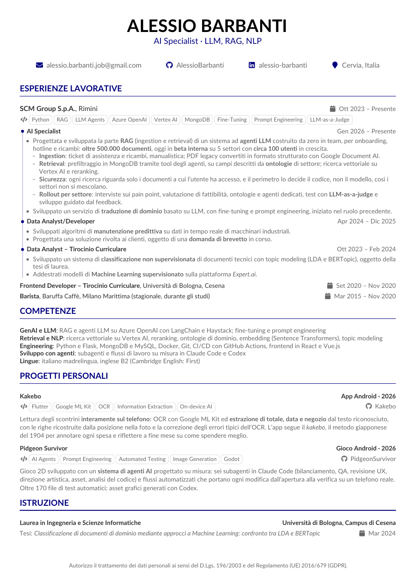

# Curriculum Vitae — Alessio Barbanti

My CV, written in LaTeX in Italian and English: one page, readable by applicant tracking systems (ATS), built and checked with a single command.

**Download the latest PDF: [English](https://github.com/AlessioBarbanti/Curriculum/releases/latest/download/Alessio_Barbanti_CV_EN.pdf) · [Italiano](https://github.com/AlessioBarbanti/Curriculum/releases/latest/download/Alessio_Barbanti_CV.pdf)**

<p align="center">
  
  
</p>

## What's inside

- **ATS-friendly PDF.** The text layer matches what is printed: ligatures are disabled (`fi` stays two letters), words are never split across lines, icons are hidden from text extraction, and the file is PDF/A-1b.
- **One source, two languages.** Every text sits next to its translation as `\tr{italiano}{english}`, so the two versions cannot drift apart. Each PDF declares its own language, title and author.
- **Checked build.** `scripts/build.py` fails if either version spills onto a second page or if any text crosses the margins or overlaps other text, and shows which text.
- **Review agents.** Two [Claude Code](https://claude.com/claude-code) subagents review the CV: one for content, one for style.

## Structure

```
src/cv.tex             header, section order, footer
src/sections/          one file per section: experience, skills, projects, education
src/cv.cls             layout and macros: \tr, \cvcompany, \cvrole, \cveducation, \cvproject, \cvskill, \cvtag
src/*.xmpdata          PDF metadata (title, author, language) for each version
scripts/build.py       build, checks, previews and release
scripts/test_build.py  tests for the log checks in build.py
docs/preview*.png      the previews above, refreshed by scripts/build.py
.claude/agents/        review agents
```

## Build

Needs Python 3 (standard library only), pdfLaTeX from TeX Live and `pdftoppm`. On Ubuntu, also under WSL on Windows:

```bash
sudo apt install --no-install-recommends texlive-latex-extra texlive-fonts-recommended texlive-fonts-extra poppler-utils
```

Then:

```bash
scripts/build.py          # from Windows: wsl scripts/build.py
```

```
[it] Pages: 1
[it] Past the margins: none
[it] PDF: build/cv.pdf
[en] Pages: 1
[en] Past the margins: none
[en] PDF: build/cv-en.pdf
```

The exit code is `0` when everything is fine. Otherwise the script prints the LaTeX error with file and line, the page count, or the overflowing text and by how much it overflows.

After changing `build.py`, run its tests with `python3 scripts/test_build.py`.

## Publishing a new version

Commit and push the changes, then:

```bash
scripts/build.py --release
```

This creates a GitHub release named after today's date (`2026-10-11`, then `2026-10-11.2` for a second one on the same day) with `Alessio_Barbanti_CV.pdf` and `Alessio_Barbanti_CV_EN.pdf` attached. The download links above always point to the latest release. It needs the [GitHub CLI](https://cli.github.com/); under WSL the Windows `gh.exe` works as well.

## Review agents

In Claude Code, from this folder:

- `cv-revisore` reviews the content: impact, relevance, consistency, missing sections.
- `cv-stile` reviews the writing: grammar, typos, consistent formatting, plain wording.

Both only read the files and propose changes as ready-to-paste LaTeX. Their prompts are in Italian, and they review both languages.

## Credits

The layout started from [techResume](https://github.com/alexcalabrese/techResume) by Alex Calabrese, a customized version of [AltaCV](https://github.com/liantze/AltaCV) by LianTze Lim.

## License

- `src/cv.cls`: [LPPL 1.3c](https://www.latex-project.org/lppl/lppl-1-3c/) or later, as a derivative of AltaCV.
- `scripts/` and `.claude/agents/`: MIT.
- The CV itself (`src/cv.tex`, `src/sections/`, `src/*.xmpdata`, the previews and the released PDFs): © Alessio Barbanti, all rights reserved.

Details in [LICENSE](LICENSE).
